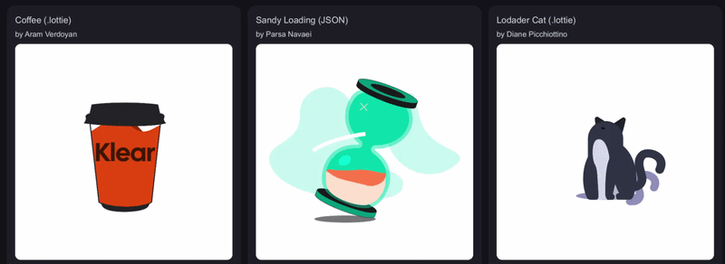

# blinc_lottie

Lottie animation player for [Blinc](https://github.com/project-blinc/Blinc) sketches.

Implements `blinc_canvas_kit::Player` so a parsed Lottie scene can be dropped
directly into any `Sketch`:

```rust
use blinc_canvas_kit::prelude::*;
use blinc_core::layer::Rect;
use blinc_lottie::LottiePlayer;

struct Hero {
    logo: LottiePlayer,
}

impl Sketch for Hero {
    fn draw(&mut self, ctx: &mut SketchContext, t: f32, _dt: f32) {
        ctx.play(&mut self.logo, Rect::new(40.0, 40.0, 200.0, 200.0), t);
    }
}

fn build() -> Div {
    let logo = LottiePlayer::from_json(include_str!("logo.json")).unwrap();
    sketch("hero", Hero { logo })
}
```



## Loading

Raw Bodymovin JSON:

```rust
let player = LottiePlayer::from_json(include_str!("scene.json"))?;
```

dotLottie archives (zipped bundles of `.json` + image / font assets —
what most exporters and marketplace sites ship now):

```rust
let player = LottiePlayer::from_dotlottie_bytes(include_bytes!("scene.lottie"))?;
```

Both v1 (`animations/` layout) and v2 (`a/`) archive shapes are accepted.
Bundled fonts (`f/` in v2, fonts referenced by a layer's `t.d.k[].fn`) are
extracted and registered against the global font registry at load time so
`ty: 5` text layers resolve against the author's intended face.

## Supported features

| Area | Support |
| --- | --- |
| Layer kinds | Solid (`ty: 1`), Image (`ty: 2`), Null (`ty: 3`), Shape (`ty: 4`), Text (`ty: 5`), Precomp (`ty: 0`) |
| Transforms | Animated position / scale / rotation / anchor / opacity / skew with linear, hold, and cubic-Bezier eased keyframes |
| Shape items | `rc`, `el`, `sh`, `gr`, `tr`, `fl`, `st`, `gf`, `gs`, `tm` |
| Paths | Cubic-Bezier `sh` with per-vertex in/out tangents; keyframed path morphing when vertex count is stable |
| Strokes | Width / opacity keyframes, dash patterns, miter limit, butt / round / square caps, miter / round / bevel joins |
| Gradients | Linear + radial, multi-stop with animated stops and alpha stops, object-bounding-box normalised |
| Trim paths | `tm` with start / end / offset animation, simultaneous + individual modes, identity and empty-window fast paths |
| Effects | Drop Shadow (`ty: 25`), Gaussian Blur (`ty: 29`), Outer Glow preset (drop-shadow with zero distance) |
| Masks | Layer-level `masksProperties` with Add mode — composite under the layer's clip stack |
| Track mattes | Alpha matte (`tt: 1`) pairing the preceding `td`-marked layer as the mask source; polygon clip in the GPU path |
| Parent chains | Arbitrary-depth layer parenting with forward-reference + cycle guards |
| Playback | `play`, `pause`, `seek`, loop, reverse, per-sketch scene-time drift, marker events on the frame interval |
| dotLottie state machines | `LottieStateMachine` executes the `.lottie` archive's state-machine spec — numeric / string / boolean inputs, transitions, event sending |

## Playback controls

```rust
player.set_playing(true);
player.seek(1.25); // seconds into the scene timeline
player.set_loop(true);
player.on_marker("handshake", |player| { /* ... */ });
```

When paused, the player freezes at the last rendered scene time (via
`last_scene_t`) rather than snapping to `t = 0`, so pausing looks
continuous with the previous frame.

## dotLottie state machines

```rust
let mut sm = LottieStateMachine::from_dotlottie_bytes(bytes)?;
sm.set_boolean("hovered", true);
sm.send("click"); // dispatches to the current state's transitions
```

The state machine wraps a `LottiePlayer` and drives its play / seek /
reverse state from the transitions defined in the archive. Input slots
(`set_numeric` / `set_string` / `set_boolean`) and explicit `send` calls
cover the two transition triggers the spec defines.

## Cargo features

- **`dotlottie`** (default) — `.lottie` archive parsing plus the state-
  machine runtime. Pulls in `zip`. Callers who only load raw JSON can
  disable with `default-features = false`.
- **`images`** (default) — `ty: 2` image-layer support. Pulls in
  `blinc_image` for PNG / JPEG / base64 decoding. Disable on vector-only
  consumers to shed the image-decoding dep.

## Non-goals

- **Expression layers** (`x: "..."` JavaScript on property values).
  Porting the AE expression runtime roughly doubles the library
  footprint for a feature most exports don't use. Revisit when a
  real consumer actually needs it.
- **After Effects-only effects** outside the `ty: 25` / `ty: 29`
  pair — 3D lights, advanced particle emitters, tritone, fill /
  colour-balance effects. Out of scope — users can stack Blinc's
  own filter / effect primitives on top of the player.

See [BACKLOG.md](./BACKLOG.md) for the open items and rough priority.

## License

Apache-2.0.
